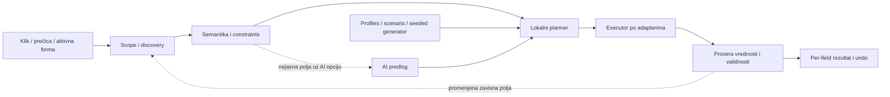

# QuikFill — tehnički i proizvodni audit

22. oktobar 2026. Fokus potvrđen sa vlasnikom: developeri i QA prvi, svakodnevni korisnici kasnije.

> Ovo je nalaz početnog stanja na commit-u `810ea82`. Naknadne popravke i browser regresije prate se u [Fazi 0](./PHASE_0_STABILIZATION.md). Originalni browser JSON ostaje baseline; audit testovi su prebačeni u redovnu regresionu suite sa očekivanim ispravnim ponašanjem.

**Preporuka: zadržati projekat i stack, a postepeno zameniti engine za izvršavanje i proveru popunjavanja.** Ne bih nastavio da dodajem generičke selektore u postojeći `fill.ts`, niti bih od nule prepisivao auth, billing, dashboard i ekstenziju. Osnova ima korisne granice između paketa. Glavni problem je što aktivni proizvod zaobilazi deo te osnove, a uspeh meri promenom DOM-a umesto potvrđenim unosom.

## 1. Šta je provereno

- Frontend commit `810ea82`, backend commit `914cbae`; oba repozitorijuma bila su bez lokalnih izmena pre audita.
- Pročitani zahtevi, konvencije, aktivni entrypointi, scanner, probe, filler, planner, AI ugovori, deo browser adaptera i backend AI/usage toka.
- Pokrenuti postojeći unit testovi, development build ekstenzije i typecheck ekstenzije.
- Napisano i pokrenuto **13 izolovanih reprodukcija postojećih defekata** u jsdom-u.
- Pokrenuto pet grupa provera u stvarnom Chromiumu, uključujući kontrolisani React checkbox. Chromium `156.0.8078.4`, React `19.2.6`.
- Pregledani zvanični sajtovi, dokumentacija i javni repozitorijumi konkurencije. Konkurentske ekstenzije nisu instalirane niti međusobno benchmarkovane; njihove tvrdnje su odvojene od naših merenja.

**Ograničenja:** ovo nije kompletan security audit backend-a, test produkcionog Gemini servisa niti puna E2E provera instalirane ekstenzije. Browser fixture izvršava stvarni kod engine-a u lokalnoj test stranici; ne proverava MV3 izolovani svet, messaging, service-worker restart ili Web Store build. Nismo dobili konkretne problematične sajtove. Reprodukcije dokazuju konkretne defekte, ali njihov procenat prolaska nije procenat podržanih sajtova.

**Rezultati provera**

| Provera                                             | Rezultat                                                                                                                                                 |
| --------------------------------------------------- | -------------------------------------------------------------------------------------------------------------------------------------------------------- |
| Postojeći testovi shared paketa + Chrome ekstenzije | 642/642 prolazi, 71 test fajl                                                                                                                            |
| Dashboard testovi                                   | 22/22 prolazi uz `NODE_OPTIONS=--no-experimental-webstorage`                                                                                             |
| Dashboard bez tog flag-a, Node 26.5.0               | 3 pada vezana za dostupnost `localStorage`; problem test okruženja, ne dokaz produkcionog auth baga                                                      |
| Typecheck Chrome ekstenzije                         | Prolazi                                                                                                                                                  |
| Development build ekstenzije                        | Prolazi; ukupno 653,17 kB, content script 163,55 kB, background 89,26 kB; veličine fajlova, ne RAM ili gzip                                              |
| Audit jsdom reprodukcije                            | 13/13 potvrđuje postojeće defekte                                                                                                                        |
| Browser reprodukcije                                | Potvrđeni neželjeni submit, lažni uspeh invalidnog broja, propusti detekcije, nepropagiranje input događaja kroz shadow granicu i React checkbox problem |
| Postojeći Playwright smoke                          | Nije završen: lokalni server blokiran sandbox-om; proverava samo dashboard, ne fill                                                                      |
| Backend testovi / produkcioni AI                    | Nisu pokretani                                                                                                                                           |

Instalirani su frontend dependency-ji iz postojećeg lockfile-a uz `--ignore-scripts`. Produkcioni kod i lockfile nisu menjani. Dodati su ovaj izveštaj i izdvojeni audit alati/testovi.

## 2. Šta projekat danas zapravo radi

Postoje dva različita toka:

| Tok                 | Šta sadrži                                                                                                                   | Status                                                                                    |
| ------------------- | ---------------------------------------------------------------------------------------------------------------------------- | ----------------------------------------------------------------------------------------- |
| Stari planirani tok | scan → klasifikacija/mappings → lokalni generator ili record → preview → fill → undo/save                                    | Veliki deo postoji u paketima i `useFillSession.ts`, ali sidepanel/options su u `legacy/` |
| Aktivni tok         | automatski scan → floating dugme → probe widgeta → backend `/ai/fill` + nasumični lokalni dropdown izbori → apply → „Filled“ | Ovo korisnik danas koristi                                                                |

Aktivni overlay ne poziva `buildPreviewPlan`, ne koristi sačuvana pravila kao glavni izvor vrednosti i ne zadržava vraćeni undo snapshot. Popup služi pre svega za auth, usage i upravljanje nalogom. Dashboard rute za data library, generators, form profiles i fill history su komentarisane.

Izvor: [aktivni overlay](/Users/kole/workspace/quikfill/frontend/apps/chrome-extension/entrypoints/content/overlay.ts:258), [stari session tok](/Users/kole/workspace/quikfill/frontend/apps/chrome-extension/lib/useFillSession.ts:61), [router](/Users/kole/workspace/quikfill/frontend/apps/app/src/router/index.ts:15).

To objašnjava kako imamo dosta arhitekture i testova, a korisniku i dalje nedostaje pouzdan osnovni alat. **Nije dovoljno da funkcija postoji u paketu; mora da bude deo aktivnog toka.**

## 3. Najvažniji potvrđeni defekti

Prioriteti ispod su predlog redosleda rada. „P0“ ovde znači prvo ukloniti pre narednog izdanja, ne tvrdnju da je ustanovljen incident u produkciji.

### P0 — datepicker može sam da pošalje formu

Posle izbora dana, fallback traži `.dp__action_select, [data-test="apply"], button[type="submit"]` u **celom dokumentu**, pa klikne prvi pronađeni element. To može biti „Save“, „Create“ ili drugi submit forme, a ne potvrda kalendara.

Reprodukovano u jsdom-u i Chromiumu: poziv `applyFill` izazvao je jedan `submit` događaj. Test ga presreće i sprečava slanje. Filler je pritom prijavio `success`.

Izvor: [fill.ts:833](/Users/kole/workspace/quikfill/frontend/packages/form-scanner/src/fill.ts:833), audit `A05`, browser `datepickerSubmit`.

**Popravka:** zabraniti generički submit iz fill engine-a. Calendar Apply sme da bude kliknut samo kroz adapter koji dokazano poseduje konkretni popup i zna tu akciju. Test „fill nikad ne submituje“ mora da važi za svaki adapter, uključujući implicitni submit preko Enter tastera.

### P1 — React checkbox izgleda popunjeno, ali aplikacija nije prihvatila unos

`setChecked` direktno dodeljuje `.checked`, pa šalje `input` i `change`. U testu sa pravim React controlled checkbox-om `onChange` se nije pozvao: DOM je bio `true`, React state `false`, QuikFill `success`. Sledeći React render vratio je checkbox na `false`.

Izvor: [fill.ts:1091](/Users/kole/workspace/quikfill/frontend/packages/form-scanner/src/fill.ts:1091), browser `reactCheckbox`. React dokumentacija opisuje vezu kontrolisanog `checked` stanja i `onChange` handlera: [React input](https://react.dev/reference/react-dom/components/input).

**Popravka:** idempotentni adapter za native toggle, sa pravilnim aktivacionim događajem i proverom nakon rendera. Ne primenjivati `.click()` naslepo: ako je stanje već tačno, klik bi ga pokvario. Test mora da proveri i React state / submit payload, ne samo DOM property.

### P1 — čest custom combobox nikada ne dolazi do custom logike

Scanner prvo proverava `isFormControl(el)`, a custom trigger tek u `else if`. Zato `<input role="combobox">` ulazi kao običan tekst input. Dobije tekst, ali ne dobije semantički izbor opcije. Ovo je relevantna DOM struktura za autocomplete komponente; u ovom auditu nisu testirane sve verzije MUI/React Select biblioteka.

Izvor: [scan.ts:150](/Users/kole/workspace/quikfill/frontend/packages/form-scanner/src/scan.ts:150), audit `A01`, browser `customDetection`.

**Popravka:** pre native fallback-a otkriti semantiku kontrole, uključujući input-based combobox. „Upisan vidljivi tekst“ i „izabrana opcija“ moraju biti odvojena stanja.

### P1 — nepouzdana verifikacija proizvodi lažne uspehe

| Slučaj                                                       | Potvrđeno ponašanje                                               | Dokaz                     |
| ------------------------------------------------------------ | ----------------------------------------------------------------- | ------------------------- |
| Broj sa `min=18 max=99`, predlog `200`                       | `.validity.valid === false`, rezultat `success`                   | A04 + Chromium            |
| Datepicker vrati jul umesto traženog juna, isti dan i godina | Rezultat `success`; `dateLanded` ne proverava mesec               | A06                       |
| Custom select prikaže „Loading…“ umesto „Serbia“             | Sama promena display teksta dovoljna je za `success`              | A13                       |
| Opšte poređenje vrednosti                                    | `-100` i `100`, kao i `Secret!` i `secret`, smatraju se istim     | A11                       |
| Cela forma                                                   | Jedan `success` **ili `assisted`** dovoljan je za oznaku „Filled“ | Pročitani aktivni overlay |

Izvori: [writeAndVerify](/Users/kole/workspace/quikfill/frontend/packages/form-scanner/src/fill.ts:176), [selectionLanded](/Users/kole/workspace/quikfill/frontend/packages/form-scanner/src/fill.ts:745), [dateLanded](/Users/kole/workspace/quikfill/frontend/packages/form-scanner/src/fill.ts:846), [valuesMatch](/Users/kole/workspace/quikfill/frontend/packages/form-scanner/src/mask.ts:116), [zbirni rezultat](/Users/kole/workspace/quikfill/frontend/apps/chrome-extension/entrypoints/content/overlay.ts:358).

**Popravka:** poređenje specifično po tipu. Brojevi čuvaju znak i decimalni separator; datum poredi godinu/mesec/dan; tekst čuva značajne znakove; maske imaju sopstveni comparator. Odvojeno proveriti da li je vrednost primenjena i da li je validna. U QA režimu namerno invalidan scenario može biti uspešno primenjen, ali mora jasno da kaže „uneseno, validacija odbija“, ne da glumi validan fill.

### P1 — identitet polja i opseg nisu dovoljno pouzdani

- **Radio grupe:** ključ je `frame + name`, bez vlasničke forme i shadow root-a. Dve forme sa istim radio `name` spajaju se u jednu grupu. `A03`.
- **Shadow rescan:** stari `data-qf-id` markeri čiste se samo u početnom root-u, ne rekurzivno. Posle ponovnog skeniranja stari disabled element i novi aktivni element mogu nositi isti ID; fill pogodi stari i preskoči novo polje. `A09`.
- **Dropdown opcije:** discovery može preći na globalni `document` i uzeti opcije drugog, čak skrivenog lista. `A07` potvrđuje takvo pronalaženje; ne tvrdi da je svaka pronađena opcija i kliknuta.
- **Aktivni overlay:** i probe i apply dobijaju ceo `doc`, iako korisnik klikne dugme jedne forme. Time se ne koristi postojeći mehanizam ograničavanja izvršenja na formu.
- **Dva fill-a:** blokada u `onFill` proverava status konkretnog dugmeta. Globalni `busy` zaustavlja rescan, ali ne zabranjuje start drugog dugmeta; dve operacije mogu ponovo skenirati/stampati isti DOM. Ovo je nalaz iz koda, bez konkurentnog browser testa.

Izvori: [radio key](/Users/kole/workspace/quikfill/frontend/packages/form-scanner/src/scan.ts:97), [marker cleanup](/Users/kole/workspace/quikfill/frontend/packages/form-scanner/src/scan.ts:201), [option scopes](/Users/kole/workspace/quikfill/frontend/packages/form-scanner/src/widget-dom.ts:131), [onFill](/Users/kole/workspace/quikfill/frontend/apps/chrome-extension/entrypoints/content/overlay.ts:242).

**Popravka:** `runId + document/frame + root + form owner + field identity`, serijalizovan executor po tabu, snapshot verzija, ponovno razrešavanje samo unutar potvrđenog opsega. Za portal listu dozvoliti izlazak iz forme samo uz proverenu vezu sa trigger-om. Ako SPA zameni celu formu tokom AI poziva, stari plan se poništava; ne prelazi se automatski na sličan element u dokumentu.

### P1/P2 — nedostaju adapteri i gube se postojeće mogućnosti

| Problem                   | Nalaz                                                                                                                                                     |
| ------------------------- | --------------------------------------------------------------------------------------------------------------------------------------------------------- |
| ARIA-only checkbox/switch | Scanner ih ne vidi; A02                                                                                                                                   |
| Google Places             | Scanner ima `autocompleteHint`, ali aktivni AI builder ignoriše tu informaciju i bira `nativeInput`; A08. Stari planner ispravno bira assisted strategiju |
| `fieldset disabled`       | Input nema svoj `disabled` atribut, pa se skenira i piše kao enabled; A10                                                                                 |
| Shadow input događaji     | `new Event(type, { bubbles: true })` nema `composed: true`; Chromium potvrđuje da document listener ne dobije input događaj                               |
| Ograničenja vrednosti     | Scanner čita maxlength/minlength, ali aktivni AI ugovor ih ne prenosi; A12 za maxlength. `step` se ne modeluje u tom skeniranju                           |
| Async lookup              | Probe daje 600 ms, zatim postavlja `remoteOptions`; lokalni picker takav widget izostavlja. Search fill fallback čeka svega tri `setTimeout(0)` ciklusa   |
| Dependent dropdowns       | Opcije se probe-uju pre promene roditeljskih polja; nema kontrolisanog „country → sačekaj state opcije → state → city“ izvršenja                          |
| Native multiple select    | Čitanje podržava više vrednosti, upis je scalar `.value`; nema punog skupa izbora                                                                         |
| Iframe/shadow UI          | Scanner/filler imaju rekurziju, ali overlay `resolveGroupRoot` koristi običan `doc.querySelector`; nema ravnopravnog UI/frame toka                        |

Izvori: [AI strategy](/Users/kole/workspace/quikfill/frontend/packages/ai/src/fill-request.ts:131), [probe budget](/Users/kole/workspace/quikfill/frontend/packages/form-scanner/src/probe.ts:65), [events](/Users/kole/workspace/quikfill/frontend/packages/form-scanner/src/fill.ts:1104), [overlay root lookup](/Users/kole/workspace/quikfill/frontend/apps/chrome-extension/entrypoints/content/overlay.ts:572).

To su različite klase problema. Jači AI model ne može da popravi nepokrenuti React handler, pogrešan element, prekratko čekanje ili nedostajuću custom kontrolu.

## 4. Arhitektonski i proizvodni problemi

**AI je na kritičnom putu i kada nije potreban.** Ime, email, broj i standardan datum ne treba da čekaju servis. Trenutno auth, mreža, quota i model mogu da zaustave osnovnu vrednost alata. Dropdown-only forma ima lokalni put, ali se floating dugme ipak krije kad se potroši AI quota.

**Random ne znači dobar QA scenario.** Custom dropdowni se biraju preko `Math.random()`, a backend namerno proizvodi raznovrsne AI vrednosti. To otežava ponavljanje greške. Random izbor države uz nezavisno generisanu adresu i telefon može dati semantički nekonzistentan zapis. Lokalni seeded generator već postoji, ali treba dodati scenario/persona kontekst i stvarnu locale implementaciju; `locale` parametar u sadašnjem generatoru nije dovoljan.

**Prepisivanje je trenutno implicitno.** Aktivni tok namerno ne filtrira već popunjena i sensitive polja. Ne šalje njihove postojeće vrednosti modelu, ali može da ih prepiše generisanim. Za QA je unos test password-a legitiman; za svakodnevnog korisnika zamena stvarnog podatka mora biti zaseban izbor. Predlog: default „samo prazna“, „zameni postojeće“ kao eksplicitna opcija i odvojeni test-data/saved-data režimi. OTP i CAPTCHA ne generisati kao da možemo da ih rešimo.

**Nema korisnog objašnjenja neuspeha u aktivnom UI-ju.** Engine vraća per-field rezultate i snapshot, ali overlay zadrži samo boolean rezultat. Korisnik dobije „Filled“ ili „Try again“, a ne zna da je lookup ostao nepotvrđen ili da je pet kontrola izostavljeno.

**AI generisanje i uspešan fill pomešani su u metrikama.** Backend troši fill quota posle modelskog odgovora, pre nego što browser proveri primenu; to važi i kad validacija modelskog odgovora ostavi prazan niz. Ako se naplaćuje generisanje, to treba tako nazvati. Metrika pouzdanosti mora da dolazi iz rezultata izvršenja, ne iz uspešnog HTTP odgovora.

**Backend ima dodatne rizike za kasniji hardening.** Provera quota i povećavanje brojača nisu jedna rezervacija/operacija; konkurentni zahtevi mogu proći istu proveru. Audit zapis, usage i brojači pišu se kroz `Promise.all`, bez jedne vidljive transakcije/idempotency ključa na ovom nivou. Ovo je nalaz iz toka koda, nije reprodukovan DB incident. [AiService](/Users/kole/workspace/quikfill/services/src/modules/ai/application/ai.service.ts:66).

**„Redacted“ metadata nije automatski bez ličnih podataka.** Pozitivno: raw HTML i `currentValue` ne ulaze u aktivni zahtev. Ali labela, opcija ili page title mogu sami sadržati ime klijenta, adresu ili broj predmeta. `redactText` uklanja HTML i skraćuje string, ne anonimizuje. Backend čuva kompletan sastavljeni prompt. Potrebno je definisati minimalni kontekst, retention i lokalni režim koji ništa ne šalje.

**Tokeni su background-owned po konvenciji, ne strogo izolovani od content script-a.** Nalaze se u `chrome.storage.local`; u pregledanom kodu nema `setAccessLevel`. Chrome dokumentuje da je local storage podrazumevano dostupan content script-ovima. To nije dokaz da sajt može direktno pročitati tokene. Predlog je ograničiti storage na trusted contexts i javne settings/state snapshot-e izložiti kroz validirane poruke. [Auth store](/Users/kole/workspace/quikfill/frontend/packages/browser-adapter/src/auth-store.ts:20), [Chrome Storage API](https://developer.chrome.com/docs/extensions/reference/api/storage).

## 5. Koliko je zaista lightweight

Development paket od oko **653 kB nije dokaz velikog ili sporog proizvoda**. Vue popup nije glavni razlog što custom forme ne rade. Ne postoji razlog da sada menjamo Vue, WXT ili NestJS zbog ovog problema.

Veći rizik je rad koji se obavlja na svakoj stranici:

- Content script se deklarativno učitava za `<all_urls>`.
- Scanner prolazi `querySelectorAll('*')`; dodatne helper funkcije ponavljaju pretrage podstabala.
- MutationObserver na body subtree-u ponovo skenira dokument uz debounce od 300 ms.
- Overlay montira globalne capture event handlere i layout/resize logiku.
- Otvaranje n dropdowna bez opcija može potrošiti približno `n × 600 ms` samo na probe deadline-ove, pre AI poziva.

Nisu merene CPU/RAM vrednosti na velikim stvarnim SPA aplikacijama. Ovo su identifikovani izvori troška, ne izmereni performansni regresioni procenti.

**Predlog:** default aktivacija preko toolbar-a, prečice ili context menija. Floating dugme kao opcija za odobrene sajtove. U ručnom režimu nema stalnog skeniranja; u automatskom mali bootstrap prati relevantne promene, a scanner/adapteri se učitavaju kad zatrebaju. `activeTab` omogućava privremeni pristup posle korisničke akcije; automatski overlay na proizvoljnom sajtu zahteva drugačiju permission odluku. [Chrome activeTab](https://developer.chrome.com/docs/extensions/develop/concepts/activeTab), [content scripts](https://developer.chrome.com/docs/extensions/develop/concepts/content-scripts/).

Početni budžeti za buduće merenje, **ne sadašnja merenja**: scan p95 ispod 100 ms na definisanom fixture-u od 100 polja/10.000 DOM čvorova; lokalni native fill 50 polja ispod jedne sekunde; nula fill mrežnih poziva u lokalnom režimu; nula scan ciklusa u neaktivnom ručnom režimu. Za async widgete meriti posebno vreme zavisno od sajta. Dokumentovati računar, browser i fixture verzije pre poređenja.

## 6. Konkurencija i šta iz nje vredi uzeti

Ovo je poređenje dokumentovanih sposobnosti, ne tvrdnja da smo nezavisno potvrdili kvalitet svakog proizvoda na istim formama. Stanje izvora provereno 22.10.2026.

| Proizvod    | Relevantna sposobnost / pozicioniranje                                                                              | Pouka za QuikFill                                                         | Granica dokaza                                                                                                     |
| ----------- | ------------------------------------------------------------------------------------------------------------------- | ------------------------------------------------------------------------- | ------------------------------------------------------------------------------------------------------------------ |
| Fake Filler | Jedan klik/prečica, fake podaci, custom field pravila, URL profili; javni Pro cenovnik $3.99 mesečno / $40 godišnje | Osnovni fake fill mora biti brz i koristan bez komplikovanog setup-a      | Tvrdnja o framework podršci nije garancija za sve custom widgete; postoji otvorena prijava custom element problema |
| Fake Data   | Programabilna pravila, pamćenje vrste podatka, proširivanje za custom elemente                                      | Napredni korisnici trebaju način da nauče alat specifičnoj formi          | Sajt opisuje mogućnosti, ne daje naš zajednički benchmark                                                          |
| Filler      | Jednostavan Fill/Save/Profiles tok, lokalni storage, country/email podešavanja                                      | Sačuvaj scenario i ponovi ga je očekivana funkcija                        | Dokumentacija priznaje ograničenja neobičnih polja i shadow DOM-a                                                  |
| Automa      | Workflow blokovi za browser automatizaciju, forme i ponavljajuće korake                                             | Koristan model čekanja, redosleda i ponovljivosti                         | Širi proizvod i više konfiguracije; nije direktan UX model za lightweight autofill                                 |
| Axiom       | Posebne browser akcije; native select odvojen od custom dropdown klikova                                            | Adapter treba da izvrši semantičku radnju, ne univerzalnu dodelu `.value` | Dokumentacija ove akcije nije dokaz kompletne kompatibilnosti Chrome ekstenzije                                    |

Izvori: [Fake Filler](https://fakefiller.com/), [njegova pravila/profili](https://github.com/FakeFiller/fake-filler-extension/wiki/Customization-using-Custom-Fields-and-Profiles), [custom element issue](https://github.com/FakeFiller/fake-filler-extension/issues/229), [Fake Data](https://fakedata.pro/), [Filler dokumentacija](https://getfiller.dev/docs), [Automa repozitorijum](https://github.com/AutomaApp/automa), [Axiom select-list dokumentacija](https://axiom.ai/docs/developer-hub/api/step-functions/select-list/).

Još jedan mali javni projekat, [ronedata/form-filler-extension](https://github.com/ronedata/form-filler-extension), dokumentuje čekanje promena posle dependent dropdowna i form maps. Koristan je kao referenca za scenario koji treba pokriti, ne kao dokaz zrelosti. Njegovo opisano direktno vraćanje hidden ID-jeva ne bih preuzeo kao generičku strategiju: podaci i aplikaciono stanje mogu postati nekonzistentni.

**Proizvodna prilika:** „jednim klikom popuni modernu formu, sa smislenim i ponovljivim test podacima; jasno pokaži šta nije završeno“. AI može pomoći semantici, ali ne treba da bude jedini razlog za kupovinu. Glavna razlika bi bili proverena kompatibilnost, sačuvani scenariji i pouzdano ponavljanje.

## 7. Šta zadržati, menjati i odložiti

| Deo                                                                    | Odluka                               | Obrazloženje                                                                        |
| ---------------------------------------------------------------------- | ------------------------------------ | ----------------------------------------------------------------------------------- |
| WXT + Manifest V3 + TypeScript                                         | Zadržati                             | Build radi; nije izvor pronađenih defekata                                          |
| Vue popup i postojeći UI paket                                         | Zadržati, pojednostaviti flow        | Nema potrebe za promenom framework-a                                                |
| Zod ugovori, odvojen DOM package, browser adapter                      | Zadržati i uskladiti                 | Dobre granice, ali aktivni i stari tok moraju koristiti iste odluke                 |
| Lokalni generator, classifier, profile matching                        | Ponovo uključiti kroz jedan planner  | Korisna osnova koja je van glavnog toka; dopuniti constraints/persona/locale        |
| `scan.ts`, `fill.ts`, `probe.ts`, `widget-dom.ts`                      | Postepeno zameniti ključne delove    | Trenutni generički fallback-i mešaju detekciju, kontrolu, navigaciju i verifikaciju |
| Overlay orchestration                                                  | Prepisati oko jedne fill sesije      | Scope, lock, cancel, partial rezultat i undo su obavezni                            |
| Backend auth, billing, postojeća baza                                  | Zadržati za cloud opcije             | Ne blokirati lokalni fill nalogom ili mrežom                                        |
| Legacy sidepanel, paused Figma adapter, neaktivne dashboard rute       | Zamrznuti, uklanjati posle migracije | Ne brisati korisnu logiku pre prenosa i provere podataka                            |
| Workflow recorder, univerzalni browser agent, timovi, nove integracije | Odložiti                             | Troše fokus dok osnovni autofill još nije pouzdan                                   |

Ne preporučujem „big bang“ rewrite. Migracija ide adapter po adapter, iza feature flag-a, sa mogućnošću vraćanja prethodne verzije i verzionisanim sačuvanim profilima.

## 8. Predloženi engine



**Discovery** vraća kontrolu sa stabilnim kontekstom, a ne samo CSS selectorom. Logički podaci mogu biti serijalizovani; živi element handle/WeakMap ostaje u content script-u. U kontrolu spadaju root/frame/form, accessible label, tip, opcije, constraints i procenjeni nivo podrške.

**Planner** odvojeno odlučuje _šta uneti_. Prioritet: eksplicitno korisničko pravilo → sačuvani scenario/record → deterministički generator → opcioni AI za nejasnu semantiku. Form-level seed i persona obezbeđuju vezu ime/email/adresa/država, a ne nezavisne random vrednosti. QA profili: valid, boundary, intentionally invalid i ponavljanje istog scenarija.

**Adapter** odlučuje _kako uneti_. Mali ugovor: `detect`, `read`, `prepare`, `write`, `verify`, `restore`, uz timeout/cancel kontekst i prijavu sposobnosti. Prvo native input/select/toggle, zatim ARIA combobox/listbox, pa specifični adapteri za biblioteke kada generički ARIA ugovor nije dovoljan. Isti adapter radi probe i fill; semantički izbor ne sme tiho postati „random druga opcija“.

**Executor** serijalizuje interakcije koje dele fokus/popovere. Čeka proverljivi uslov do deadline-a, umesto fiksnog broja tick-ova. Ako roditeljska kontrola promeni formu, ponovo skenira pogođeni region. Čuva korisničke izmene nastale dok se čeka AI. Prekid na navigaciji/zameni forme vraća precizan rezultat, ne globalni selector fallback.

**Verifier** proverava sveža stanja posle re-rendera i validnost polja. Generički extension ne može univerzalno pročitati privatni state svakog framework-a; zato adapter beleži koju vrstu dokaza ima. Browser testovi naših fixture-a dodatno proveravaju state i finalni payload. Za nepotvrđen lookup rezultat je `needs-user`, nikada puni uspeh.

**Rezultat** treba da razlikuje `applied-valid`, `applied-invalid`, `skipped`, `unsupported`, `needs-user`, `failed` i `cancelled`, sa razlogom i adapterom. Na UI-ju: „18/22 popunjeno · 2 traže izbor · 2 nepodržana“, mogućnost ponavljanja samo neuspelih i undo samo za potvrđeno promenjena polja.

**Undo** je uslovan: ne prepisuje naknadnu korisničku izmenu, vezan je za konkretnu sesiju i proverava restore. Native multiple select, radio grupa, prazan custom select i datepicker zahtevaju različite snapshot-e. Generički `previousDisplayText` nije dovoljan.

**Browser granice:** cross-origin iframe zahteva dozvole i izvršavanje u odgovarajućem frame-u; dodavanje `all_frames` samo po sebi ne rešava sve. Synthetic događaji nisu trusted događaji. Closed shadow root i canvas forme ne treba obećavati kao podržane običnim DOM adapterom. `chrome.debugger`/CDP bih razmatrao tek kao zaseban napredni režim, zbog permissions-a i složenosti. [Chrome content scripts](https://developer.chrome.com/docs/extensions/develop/concepts/content-scripts/), [MDN isTrusted](https://developer.mozilla.org/en-US/docs/Web/API/Event/isTrusted).

## 9. Matrica koju treba napraviti pre obećanja o kompatibilnosti

Potrebne su prave biblioteke u browser fixture-ima, sa zabeleženim verzijama. Ručno napisani HTML koji liči na MUI nije MUI integracioni test.

| Oblast               | Minimalne varijante                                                                                                                   |
| -------------------- | ------------------------------------------------------------------------------------------------------------------------------------- |
| Native               | text/email/number/date/time, required/pattern/min/max/step, select single/multiple, disabled fieldset, checkbox/radio po form owner-u |
| React                | controlled/uncontrolled input, checkbox/radio, React Hook Form, Formik; dokaz kroz state i payload                                    |
| Vue                  | `v-model`, Reka/Radix Vue, Vuetify/PrimeVue kontrola; re-render i validator                                                           |
| Custom select        | Radix/shadcn, MUI Select/Autocomplete, React Select, Ant Design Select, Headless UI                                                   |
| Životni ciklus       | render on open, portal, dialog/drawer, focus trap, promena node-a, otvorena dva widgeta                                               |
| Async                | 50/300/800/2000 ms odgovor, minimalni broj karaktera, nema rezultata, country/state/city zavisnost                                    |
| Virtualizacija       | cilj van prve grupe vidljivih opcija, pretraga, scroll, multi-select                                                                  |
| Datumi/maske         | sr-RS/en-GB/en-US, DD/MM vs MM/DD, min/max, drugi mesec/godina, caret/blur, readonly input                                            |
| Granice              | open shadow, nested shadow, same-origin iframe, dozvoljeni cross-origin frame, restricted page                                        |
| Pouzdanost           | dva brza fill klika, SPA navigation tokom AI-ja, timeout, offline, quota, service-worker restart                                      |
| Neposredne posledice | nema submit-a; nema izmene druge forme; nema gubitka ručnog unosa; undo posle re-rendera                                              |

Meriti odvojeno: recall detekcije, preciznost ciljanja, uspešan upis, validan unos, false-success, latency. Jedan zbirni „accuracy“ broj skriva baš probleme koje sada imamo. Za release suite tolerancija na pogrešno polje i nenamerni submit treba da bude nula; procenat završenih podržanih kontrola ima smisla tek uz objavljen nazivnik i verzije fixture-a.

## 10. Redosled realizacije

**Faza 0 — zaustaviti konkretno loše ponašanje.** Ukloniti submit fallback; prestati sa random zamenom neuspele eksplicitne vrednosti; prikazati partial/assisted rezultat; dodati globalni lock i scoped execution; čuvati undo snapshot. Reprodukcije pretvoriti u testove očekivanog ispravnog ponašanja. Izlaz: nema submit-a/pogrešne forme u corpus-u i nema oznake punog uspeha za delimičan rezultat.

**Faza 1 — vratiti brz lokalni proizvod.** Jedan planner za sve ulaze; native i React/Vue input/toggle adapteri; validacija i exact comparison; default „samo prazna“; deterministic seed/persona; osnovni fill radi bez naloga, AI-ja i interneta. Izlaz: instalacija → prvi koristan fill bez dashboard-a, uz prolaz native/framework browser fixture-a.

**Faza 2 — rešiti custom kontrole.** ARIA combobox i toggle; prioritetne biblioteke iz matrice; portal ownership; async waits; dependent controls; versioned re-scan; locale-aware datumi. Izlaz: svaka deklarisana podrška ima fixture i proveru stvarnog rezultata posle re-rendera. Nepokriveni widget jasno se prijavljuje.

**Faza 3 — ponovljivost i QA vrednost.** Lokalni recipes, per-field fixed/generated/skip, export/import scenarija, retry samo neuspelih, sačuvani seed i korelisani podaci, opcioni invalid/boundary slučajevi. Izlaz: ista forma + isti scenario daje isti rezultat na ponovnom pokretanju.

**Faza 4 — opcioni cloud i svakodnevni korisnici.** AI za nejasna polja, sync, account i billing; metadata minimizacija/retention; quota rezervacije i idempotency; zaseban saved-data režim sa zaštitom postojećih vrednosti. Tek zatim šira obećanja o produktivnosti i dodatni surface-i.

Prvi implementacioni paket treba da bude Faza 0 plus browser fixture harness. Posle njega postoji stabilna osnova da izmerimo napredak umesto da popravljamo pojedinačan sajt i nadamo se da ostali nisu regresirali.

## 11. Reprodukcije i ponavljanje audita

Originalne reprodukcije su posle audita pretvorene u redovne regresione testove. Svih trinaest sada proverava ispravno ponašanje, uključujući A02 u fazi 2 i A12 u fazi 4. Brojevi u rezultatima audita iznad opisuju početno stanje.

- [13 jsdom reprodukcija](/Users/kole/workspace/quikfill/frontend/packages/form-scanner/src/audit-regressions.test.ts)
- [Izolovani Vitest config](/Users/kole/workspace/quikfill/frontend/packages/form-scanner/audit/vitest.config.ts)
- [Chromium + React harness](/Users/kole/workspace/quikfill/frontend/packages/form-scanner/audit/browser.mjs)
- [Sačuvani browser rezultati](/Users/kole/workspace/quikfill/frontend/packages/form-scanner/audit/browser-results.json)

Iz frontend direktorijuma:

```sh
pnpm --filter @quikfill/form-scanner exec vitest run --config audit/vitest.config.ts
pnpm --filter './packages/**' --filter @quikfill/chrome-extension -r test
NODE_OPTIONS=--no-experimental-webstorage pnpm --filter @quikfill/app test
pnpm --filter @quikfill/chrome-extension build:dev
pnpm --filter @quikfill/chrome-extension typecheck
```

Browser harness koristi React iz privremenog direktorijuma da ne menja proizvodne dependency-je. Putanja do Chromiuma je opciona; potrebna je ako lokalni Playwright nema svoju odgovarajuću browser verziju:

```sh
npm install --prefix /private/tmp/quikfill-audit-react --no-audit --no-fund --ignore-scripts react@19.2.6 react-dom@19.2.6
QF_AUDIT_CHROMIUM=/absolute/path/to/chrome-headless-shell node packages/form-scanner/audit/browser.mjs
```

Prilikom narednog poređenja koristiti isti browser build ili eksplicitno zabeležiti promenu. U ovom auditu korišćen je već instaliran Chromium build, ne Playwright-ov očekivani revision 1223. Backend nije pokretan, nije pozivan stvarni AI i ništa nije deployovano.
